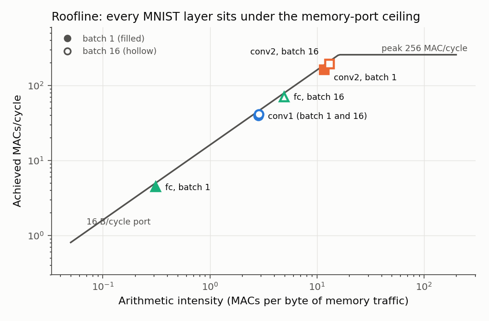
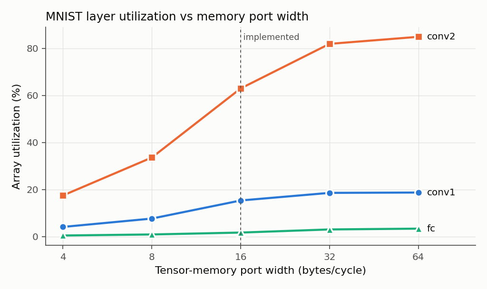
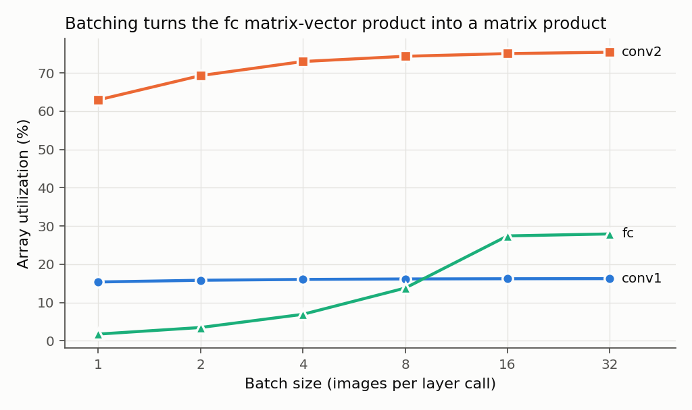

# INT8 Systolic-Array NPU

A 16×16 output-stationary INT8 matrix-multiply accelerator in SystemVerilog. It runs a quantized MNIST CNN **bit-exactly** against an integer reference, and was taken through sky130 synthesis and multi-corner static timing, an FPGA build, and a validated cycle-level performance model.

| | |
|---|---|
| **Array** | 16×16 PEs, INT8×INT8 → INT32, output-stationary, true systolic (operands hop PE to PE) |
| **Peak** | 256 MAC/cycle (12.8 GMAC/s at 50 MHz) |
| **Datapath** | ping-pong operand buffers → skew → array → capture-wave drain → 4-stage requantization epilogue (bias, 32-bit fixed-point multiply, round-half-away, ReLU, saturate) → writeback |
| **Control** | pipelined sequencer: fetch runs one tile ahead, tiles stream back to back, drain/epilogue/writeback overlap compute |
| **Interfaces** | AXI4-Lite CSRs with perf counters; one 128-bit tensor-memory port |
| **MNIST** | 98.39% INT8 accuracy (float 98.37%); 1,000 test images bit-exact in RTL |

## Results

**Performance** (MNIST, ideal memory, 50 MHz)

| | Serial sequencer (baseline) | Pipelined sequencer |
|---|---|---|
| Cycles per image | 10,149 | **4,610** (2.20×) |
| conv2 array utilization | 30.3% | **63.0%** |
| Images/s | 4,927 | **10,846** |

Every layer now runs at 78–92% of the memory-bandwidth roofline. The performance model shows that a 32-byte port would give another 1.5×.

**ASIC, SkyWater 130 nm HD** (Yosys → OpenROAD global placement, buffering, 3-corner STA)

- **Timing closed at 50 MHz at all three corners** (ss 100 °C/1.6 V: +0.07 ns; tt: +7.9 ns; ff: +8.4 ns; hold clean), after eight measured rounds of RTL and constraint fixes recorded in [the M10 log entry](docs/ENGINEERING_LOG.md)
- Area 6.0 mm²: 3.05 mm² OpenRAM SRAM macros, 1.28 mm² PE array, ~1.0 mm² epilogue

**FPGA**

- 8×8 configuration placed and routed on a Lattice ECP5-85F (Yosys + nextpnr). See [the M11 log entry](docs/ENGINEERING_LOG.md) for Fmax and utilization.
- The full 16×16 needs 324 DSPs, more than the ECP5's 156. On an AMD 7-series part it synthesizes to 42K LUTs / 28.5K FFs / 324 DSP48 / 40 BRAM36 (fits an Artix-7 200T class device; synthesis estimate only).

## Figures

| Roofline | Port-width sweep | Batch sweep |
|---|---|---|
|  |  |  |

## Verification

- **Golden models first:** a NumPy bit-exact reference for every block, an INT8 PyTorch-trained network, and an integer-only inference path.
- **Integration testbench:**
  - an AXI-Lite master drives the NPU; the memory model has latency, jitter and backpressure
  - the entire memory image is compared after every layer, so stray writes are caught too
  - runs on both iverilog and Verilator
  - covers 16×16 and 8×8 arrays
- **SVA assertions** bound into `npu_top` check the pipeline invariants (bank swaps, capture-wave spacing, output queue, AXI handshakes).
- **15 functional-coverage points**, all hit by the regression.
- **Mutation checks:** injected bugs (clear misalignment, early drain, wrong read bank, …) must fail the regression.
- **Performance model:** cycle-exact against the RTL performance counters on 450 layers.

```
python3 scripts/run_regression.py        # 14 suites + coverage closure, ~2 min
```

## Repository layout

```
src/            RTL (npu_top, sequencer, fetch, buffers, skew, array, drain, epilogue, obuf, wb, arbiter, CSR)
src/fpga/       FPGA wrapper with on-chip tensor memory
model/          golden models (MAC, GEMM, epilogue, full layer) and the performance model
compiler/       MNIST training, INT8 quantization, integer reference network
tb/unit/        block-level testbenches
tb/integration/ npu_top and MNIST testbenches (shared harness)
tb/sva/         assertions + functional coverage (bound into npu_top)
pd/             synthesis, STA, FPGA scripts, constraints, SRAM macro views, reports
scripts/        runners: tests, regression, synthesis/STA, FPGA, model validation, design-space sweeps
docs/           SPEC.md (design), ENGINEERING_LOG.md (milestone-by-milestone record), results, figures
```

## Running it

| Task | Command |
|---|---|
| Everything (regression) | `python3 scripts/run_regression.py` |
| One layer suite | `python3 scripts/run_top_test.py [--arr 8] [--harsh-mem]` |
| MNIST in RTL | `python3 scripts/run_mnist_test.py -n 1000` |
| Performance model + sweeps | `python3 -m model.perf_model`; `python3 scripts/dse.py` |
| ASIC synthesis + STA | `python3 scripts/run_synth.py --period 20` |
| FPGA build | `python3 scripts/run_fpga.py --arr 8` |

Tools: Icarus Verilog 13, Verilator 5, Yosys 0.63, OpenROAD, OpenSTA, nextpnr-ecp5, PyTorch. See [the engineering log](docs/ENGINEERING_LOG.md) for how each was set up on macOS.

## Documents

- [docs/SPEC.md](docs/SPEC.md): design specification, memory layout, register map
- [docs/ENGINEERING_LOG.md](docs/ENGINEERING_LOG.md): every milestone's decisions, results, and corrections
- [docs/results/dse.md](docs/results/dse.md): design-space exploration tables
